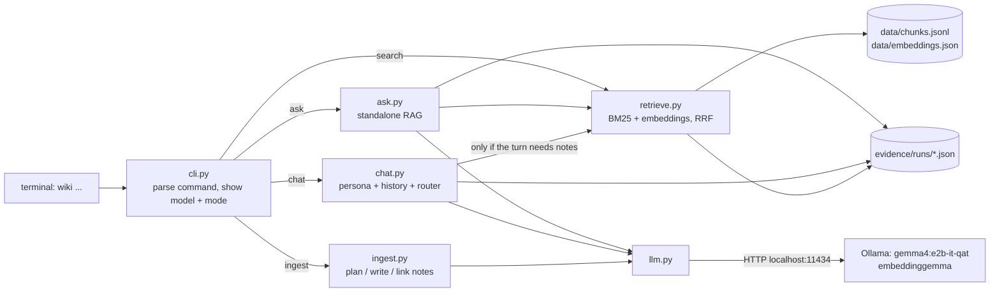
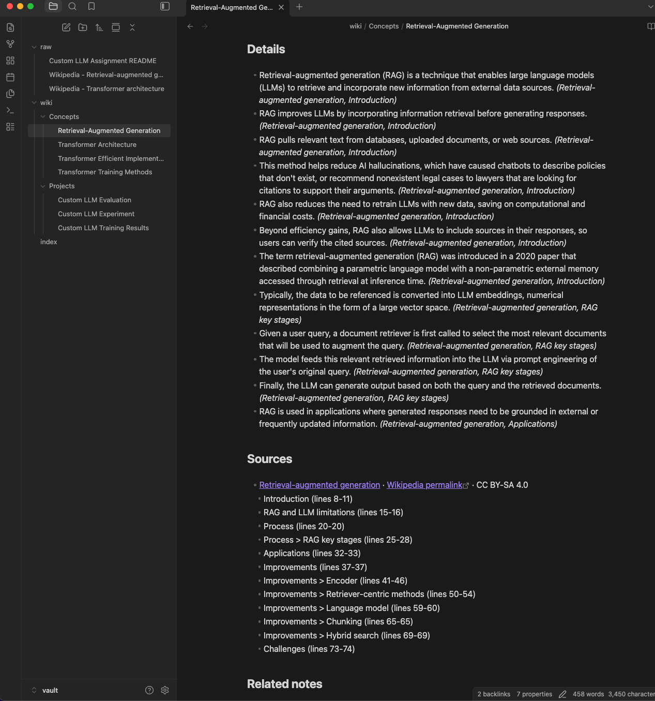
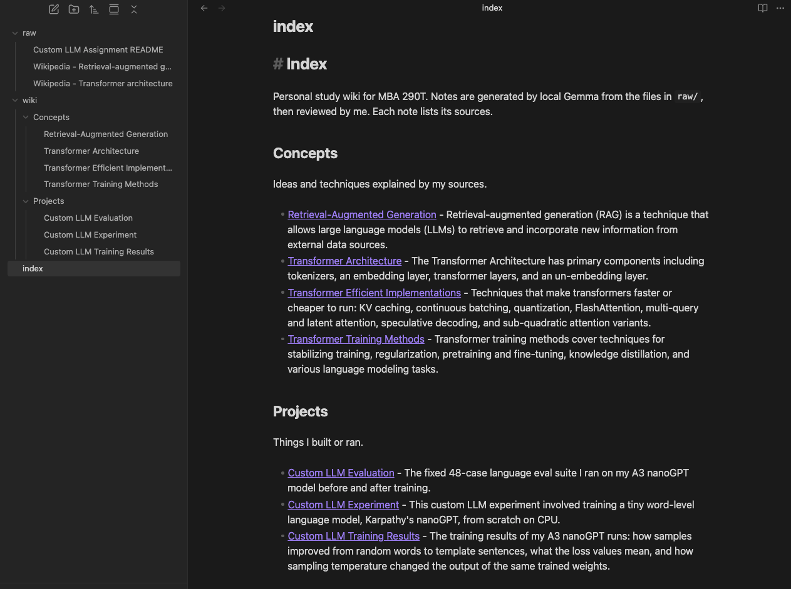
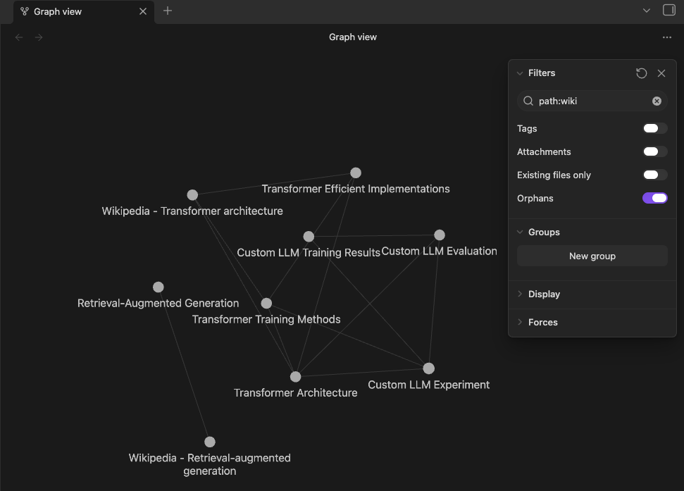

# Personal Wiki CLI: local Gemma + RAG (MBA 290T, Assignment 4)

A command-line personal study wiki that runs **fully offline** on my laptop. Local Gemma
(`gemma4:e2b-it-qat`, via Ollama) turns my sources into linked Obsidian notes and answers questions
about them. I wrote the CLI and harness myself: modes, prompts, retrieval, citation checks, and evidence
logging. There are no cloud services, no hosted embeddings, and no fallback to a remote model.

| | |
|---|---|
| **CLI and harness code** | [`wiki/`](wiki/): [cli.py](wiki/cli.py) · [ingest.py](wiki/ingest.py) · [retrieve.py](wiki/retrieve.py) · [ask.py](wiki/ask.py) · [chat.py](wiki/chat.py) · [llm.py](wiki/llm.py) |
| **Wiki (Obsidian vault)** | [`vault/`](vault/): [index.md](vault/index.md) · [wiki/](vault/wiki/) · [raw/](vault/raw/) |
| **Instructions sent to the model** | [wiki-instructions.md](prompts/wiki-instructions.md) (ask) · [persona.md](prompts/persona.md) (chat) · [chat-router.md](prompts/chat-router.md) · [ingest-instructions.md](prompts/ingest-instructions.md) |
| **Four ask-mode tests** | expected answers, written first: [tests/ask_tests.md](tests/ask_tests.md) · results: [evidence/ask_tests/results.md](evidence/ask_tests/results.md) |
| **Chat/search mode checks** | [evidence/mode_checks/summary.md](evidence/mode_checks/summary.md) |
| **Offline demo** | checklist: [demo/offline_demo.md](demo/offline_demo.md) · results: [evidence/offline/](evidence/offline/) |
| **Memory and time** | [evidence/measurements/summary.md](evidence/measurements/summary.md) |

---

## 1. Purpose and sources

The wiki is my study companion for **MBA 290T (AI)**. It answers questions about my own Assignment 3 project
and two background topics from the course: RAG and transformers.

| Source (unchanged in `vault/raw/`) | What it is | Permission |
|---|---|---|
| [Custom LLM Assignment README.md](vault/raw/Custom%20LLM%20Assignment%20README.md) | My own write-up of Assignment 3 (a nanoGPT model trained from scratch), copied from my public repo [chaekim96/custom-llm](https://github.com/chaekim96/custom-llm) | My own work |
| [Wikipedia - Retrieval-augmented generation.md](vault/raw/Wikipedia%20-%20Retrieval-augmented%20generation.md) | Plain-text extract, [revision 1377227095](https://en.wikipedia.org/w/index.php?oldid=1377227095), retrieved 2026-09-29 | CC BY-SA 4.0, attribution in the file header |
| [Wikipedia - Transformer architecture.md](vault/raw/Wikipedia%20-%20Transformer%20architecture.md) | Plain-text extract of "Transformer (deep learning)", [revision 1377565152](https://en.wikipedia.org/w/index.php?oldid=1377565152) | CC BY-SA 4.0, attribution in the file header |

**How the originals connect to the generated pages.** Each source gets a stable machine ID, e.g.
`src_bc08c49a00` (a hash of its path inside `vault/raw/`).
[`data/catalog.json`](data/catalog.json) maps each ID to the notes it produced and records which sections
went into each note. Every note lists its sources as Obsidian links back to the raw file, along with section
names and line numbers.

## 2. Device

| | |
|---|---|
| OS | macOS 15.7.4 (24G517) |
| CPU/chip | Apple M3 Pro |
| GPU | 18-core Apple GPU, Metal 3 (no dedicated VRAM; CPU and GPU share memory) |
| Memory | 18 GB unified memory. Available before the project: 29-34% free (`memory_pressure`), about 5.2-6.1 GB |
| Free disk | 17 GiB before downloads (the disk is 96% full) |

## 3. Model, runtime, and why

| | |
|---|---|
| Model | **Gemma 4 E2B**, instruction-tuned, quantization-aware trained. Ollama tag **`gemma4:e2b-it-qat`**, ID `07ea59a47401` |
| Quantization | **Q4_0** (from `ollama show` and the registry config: `"file_type":"Q4_0"`), 4.6B total parameters, 131,072-token max context (I use 8,192) |
| Download | 4.34 GB: 3.35 GB model + 0.99 GB vision projector. The tokenizer is inside the GGUF file. |
| Embedding model | **`embeddinggemma:latest`**, ID `85462619ee72`, 307.58M parameters, BF16, 768-dimensional vectors, 621 MB |
| Runtime | **Ollama 0.35.0** (`Ollama.dmg` from [github.com/ollama/ollama/releases](https://github.com/ollama/ollama/releases/tag/v0.35.0)); Metal GPU, `ollama ps` shows "100% GPU" |
| Python | 3.11.16 via uv 0.12.15. **Standard library only**: no pip dependencies |

**Why E2B.** Google's load estimates at Q4_0 are 2.9 GB (E2B), 4.5 GB (E4B), and 14.4 GB (26B A4B MoE)
([ai.google.dev/gemma/docs/core](https://ai.google.dev/gemma/docs/core)).
- **26B A4B MoE.** It only activates about 4B parameters per token, but it still has to load all 26B weights. That doesn't fit next to macOS and my other apps in 18 GB.
- **E4B.** It would need about 4.5 GB, plus context and runtime, out of the ~5-6 GB I had free.
- **E2B.** It left room for the embedding model, retrieval, and the OS.

I measured E2B on this Mac (section 8): about 1.7 GB of working memory plus about 3.2 GB of memory-mapped
weights while answering, and 4-8 s per answer. That is fast enough, so I didn't need a larger model.

**Why the `-it-qat` tag.** The plain `gemma4:e2b` tag is a 7.16 GB download and isn't 4-bit.
I checked the tag names and sizes against the Ollama registry manifests rather than guessing.

## 4. Setup (exact commands)

Do this once, while online:
```bash
# 1. Runtime: download Ollama 0.35.0 (Ollama.dmg) from GitHub releases, drag Ollama.app to /Applications, open it
# 2. Models (weights + tokenizer are stored locally in ~/.ollama/models)
/Applications/Ollama.app/Contents/Resources/ollama pull gemma4:e2b-it-qat
/Applications/Ollama.app/Contents/Resources/ollama pull embeddinggemma
# 3. This project
git clone https://github.com/chaekim96/personal-wiki.git
cd personal-wiki
uv venv --python 3.11 .venv
uv pip install --python .venv/bin/python -e .      # installs the `wiki` command (no third-party packages)
.venv/bin/wiki --help
```
After that, everything runs offline. Model weights and credentials are never committed (see [.gitignore](.gitignore)).

## 5. Commands

```bash
.venv/bin/wiki --help
.venv/bin/wiki ingest ./vault/raw                 # sources -> local Gemma -> wiki notes, index.md, retrieval index
.venv/bin/wiki ingest ./vault/raw --force         # regenerate unchanged sources too (hand-edited notes are kept)
.venv/bin/wiki search "positional encoding"       # original passages + paths; never calls Gemma
.venv/bin/wiki ask "What learning rate did I use in Assignment 3?"   # standalone cited answer or insufficient evidence
.venv/bin/wiki chat                               # Wren, study-partner persona, with conversation context
.venv/bin/wiki rename "Old Title" "New Title"     # rename, or merge into an existing note; keeps links/index/catalog in sync
```
Every command prints the model and mode, for example `wiki ask · model gemma4:e2b-it-qat · mode local`.
Local is the default. `--mode online` exits with an error, because online mode is not implemented.
If a file is missing, or Ollama or a model is unavailable, the command prints the problem and the fix
(for example "Cannot reach Ollama at http://localhost:11434 ... open /Applications/Ollama.app") instead of a traceback.

## 6. Architecture



| Part | What it is here |
|---|---|
| **Model** | Local Gemma, run by Ollama. It only sees the text my code sends it. It doesn't read files, remember conversations, or call tools on its own. [llm.py](wiki/llm.py) is the only file that talks to it: HTTP to `localhost:11434` using Python's `urllib`, with thinking turned off. |
| **Retrieval tool** | [retrieve.py](wiki/retrieve.py). It finds original passages in `vault/raw/` and returns their path, section, and line numbers. It scores passages with **BM25** (keyword matching) and **EmbeddingGemma** (cosine similarity of meaning-vectors), then merges the two rankings with Reciprocal Rank Fusion. `search` shows these results directly. |
| **RAG workflow** | `ask`: retrieve the top 5 passages, label them P1-P5, put them in a prompt with the research rules, have Gemma answer from that evidence, then check the citations. RAG supplies context when a question is answered. It does not train the model. |
| **Harness** | Everything around the model: choosing the mode, loading the right instructions file per mode, conversation context in chat, deciding when chat retrieves, building prompts, JSON schemas, citation checks, error messages, and saving every run to `evidence/runs/`. |
| **CLI** | [cli.py](wiki/cli.py): `argparse` subcommands. It prints the model and mode and turns errors into readable messages. |

**One command traced from input to output: `wiki ask "What learning rate did I use in Assignment 3?"`**
1. `.venv/bin/wiki` runs `main()` in [cli.py](wiki/cli.py). The `ask` subcommand calls `show(ask(question))`.
2. [ask.py](wiki/ask.py) calls `llm.check_model()`, which asks Ollama which models are installed and fails early with a fix if Gemma isn't available.
3. `search(question, 5)`: BM25 scores over the 95 passages in `data/chunks.jsonl`. The question is embedded with `/api/embed` (`task: search result | query: ...`), each passage is scored by cosine similarity, the two rankings are fused, and the top 5 are kept (0.04-1.36 s measured).
4. `build_prompt`: the system message is the part of [wiki-instructions.md](prompts/wiki-instructions.md) below `---`. The user message is `[P1] source | section | lines` followed by the passage text, and then the question. **There is no chat history and no persona.**
5. `llm.chat_json`: a POST to `/api/chat` with temperature 0, `num_ctx` 8192, and a JSON schema that allows only `P1`-`P5` as citations.
6. `check_citations`: every inline `[P#]` must be one of the retrieved passages and must also appear in the `citations` list. A factual answer must cite something. If this fails, the answer is shown as **"CITATION CHECK FAILED - NOT verified"**.
7. `save_run` writes `evidence/runs/<time>_ask.json`: question, all passages with paths and text, raw model output, answer, citations, check status, timings, and tokens. `show()` prints the answer, citations, retrieved passages, time, and the saved path.
   Real output: `The learning rate used was 0.001 [P1]` · P1 = `vault/raw/Custom LLM Assignment README.md`, section "2. My three choices and prediction", lines 45-54.

## 7. Design choices

| Choice | What I did and why |
|---|---|
| **Passage size** | About 250 words per passage (at most ~320). Passages are split along section headings; fragments under 40 words are merged into the next passage. Each passage keeps its source path, section path (e.g. `Architecture > Scaled dot-product attention > Attention head`), and line numbers. The Transformer extract contained about 5,000 lines of broken MathML, so the chunker keeps each `{\displaystyle ...}` formula as inline `$...$` and drops the rest. Result: 95 passages. |
| **Text sent to Gemma** | **ask:** 5 passages: 486-1,001 words, and 1,226-2,487 prompt tokens including the instructions (measured over 29 ask runs). **chat:** 4 passages, only when a turn needs them. **ingest:** up to 1,500 words of source per WRITE call. The context window is set to 8,192 tokens. |
| **Retrieval method** | Started with BM25 only. Test 2 (paraphrase) only barely made the top 5, so I added local EmbeddingGemma and RRF (hybrid search). The Test 2 passages moved from ranks 5/4 to 2/3. If Ollama is down, `search` falls back to BM25 and says so ([retrieval_changes.md](evidence/retrieval_changes.md)). |
| **Research rules (ask)** | [wiki-instructions.md](prompts/wiki-instructions.md): use only the passages; cite every fact as `[P#]`; say "insufficient" rather than guess; neutral voice. The JSON field order (answer, citations, insufficient) was chosen after comparing 4 settings ([config_runs.md](evidence/ask_tests/config_runs.md)). |
| **Persona (chat)** | [persona.md](prompts/persona.md): "Wren", an upbeat study partner, with an exact list of what it can and cannot do. Its source list is filled in from the catalog. It must never invent personal facts, must cite notes as `[N#]`, and must label its own ideas "Suggestion:". |
| **When chat retrieves** | Code rules come first: greetings, "what can you do", and "make that shorter" never search. Otherwise a small router call ([chat-router.md](prompts/chat-router.md)) returns `needs_notes` and a search query. Drafts about my own work count as needing notes. Retrieved notes are added for that turn only. If the reply uses no `[N#]` labels, the harness retries once and then flags it. |
| **Context limits** | Chat keeps the last 6 turns. Stored replies have `[N#]` rewritten as source names so they stay meaningful later. `ask` never sees chat history, so a claim made only in chat can't become evidence. |
| **Note naming** | Titles are proposed by Gemma and **validated by code** in [naming.py](wiki/naming.py): 2-6 words; no hashes, dates, UUIDs, chunk numbers, or question-style titles. The filename equals the first heading. Machine IDs and original filenames are kept in note properties and the catalog. |
| **Folders** | `vault/wiki/Concepts/` (ideas from the sources) and `vault/wiki/Projects/` (my own work). `vault/index.md` groups notes by topic with one-line descriptions. Code, chunks, embeddings, the catalog, prompts, tests, and evidence all live outside `vault/`. |
| **Source-ID mapping and re-ingestion** | The catalog stores a **saved plan** per source ID (which notes, which sections). Re-ingesting reuses the plan, so it updates the same files: I ingested the same source twice and the file list was identical. An unchanged source is skipped unless `--force` is used. `wiki rename` updates the plan, so my renames survive re-ingestion. A note I edited by hand is detected by its fingerprint and kept. |
| **Related links** | A LINK call suggests up to 3 related notes, each with a reason. Code keeps only links to titles that exist. I removed or rewrote every reason that wasn't supported by my sources ([review.md](evidence/ingest/review.md)). |
| **Model settings that mattered** | Thinking off (faster, no hidden reasoning). Temperature 0 for ask and 0.6 for chat. JSON schemas with `enum` labels: in the first ingest run, Gemma wrote `"S1"` as the detail text, which is now prevented. JSON field order for ask (section 9). |

## 8. Measured memory and response time

Measured with [tests/measure.py](tests/measure.py). It samples each Ollama process's **physical footprint** once
per second with streaming `top`; this is Activity Monitor's "Memory" figure and includes GPU/Metal memory.
It also records a `footprint` breakdown of the memory-mapped weights, which the footprint doesn't count.
The CLI process itself is measured with `/usr/bin/time -l`. "Cold" means both models were unloaded first.
([summary](evidence/measurements/summary.md))

| Run | Wall time | Gemma process peak footprint | + mapped weights | Embedding process | CLI max RSS |
|---|---|---|---|---|---|
| Ingest 3 sources, cold (`--force`; 14 Gemma calls) | **96.02 s** | **1,686 MB** | 3,178 MB | not loaded (vectors cached) | 27.0 MB |
| One answer (`ask`), cold | **8.42 s** | 1,305 MB | 1,938 MB | 104 MB (+587 MB mapped) | 28.8 MB |
| One answer (`ask`), warm | **4.38 s** | 1,699 MB | 3,178 MB | 107 MB (+578 MB mapped) | 29.1 MB |

Other real timings: the 4 ask tests took 2.2-3.6 s each to generate once warm. Embedding all 95 passages took 4.57 s.

## 9. Evidence

### Wiki (Obsidian)
7 reviewed notes. Concepts: Retrieval-Augmented Generation, Transformer Architecture, Transformer Efficient
Implementations, Transformer Training Methods. Projects: Custom LLM Experiment, Custom LLM Training Results,
Custom LLM Evaluation. Each note has a matching `# Heading`, summary, details tagged with their source section,
source links with line numbers, and related notes with reasons.
- Ingest run logs: [evidence/ingest/](evidence/ingest/). The first run failed and its log is kept. There's also a manual plan edit in [plan_edits.md](evidence/ingest/plan_edits.md) and my review against the originals in [review.md](evidence/ingest/review.md).
- Obsidian screenshots, taken with the `vault/` folder open as the vault:
  - Open note (Retrieval-Augmented Generation), showing its details, each tagged with the source section it came from, and its **Sources** section. The Sources section links to `raw/Wikipedia - Retrieval-augmented generation`, with the Wikipedia permalink, license, and the sections and line numbers used. This note has no related notes, because I removed its only link during review (it was unsupported). 
  - Index, grouped by topic (Concepts, Projects), with one-line descriptions, plus the page list in the sidebar: 
  - Graph view with filter `path:wiki`, Attachments off, and Orphans on. This filter also matches the two raw files whose names start with "Wikipedia", so they appear as source nodes linked to the notes built from them. `path:wiki/` would show only the 7 curated notes. 

### Ask-mode tests (expected behavior written first in [tests/ask_tests.md](tests/ask_tests.md))
Final setting (run 4), all local:

| Test | Question | Retrieval | Answer | Verdict |
|---|---|---|---|---|
| 1 direct | What learning rate did I use in Assignment 3? | expected passage at P1 | "The learning rate used was 0.001 [P1]." | **PASS** |
| 2 paraphrased | Why is RAG cheaper than retraining a model when information changes? | both expected passages retrieved | "RAG reduces the need to retrain LLMs with new data, which saves on computational and financial costs [P2]." | **PASS** |
| 3 two sources | How many attention heads did my A3 model have, and why is multi-head attention easy to parallelize? | README "2 blocks, 4 heads" **not retrieved** (rank 28) | "The smallest GPT-2 model has 12 attention heads [P2] ..." | **FAIL** |
| 4 unsupported | What validation loss did my A3 model reach at 10,000 training steps? | tempting 3,000-step loss table retrieved | "Insufficient evidence ..." with the 3,000-step values correctly labeled | **PASS** |

Each result has retrieved passages and paths, the model's raw output, citations, and my claim-by-claim check:
[results.md](evidence/ask_tests/results.md). All four settings I tried are compared in [config_runs.md](evidence/ask_tests/config_runs.md),
and the retrieval before/after is in [retrieval_changes.md](evidence/retrieval_changes.md).

### Chat and search mode checks
[summary](evidence/mode_checks/summary.md) · [chat transcript](evidence/mode_checks/chat_session.txt)
- "what can we do?" / "what can you help me with?": accurate capabilities, no notes search, no citations. PASS
- A draft, then "make that shorter": used the conversation. PASS (but the plan wasn't labeled "Suggestion:")
- `search "positional encoding"`: passages and paths, no generated answer. PASS
- Standalone `ask "What does KV caching do?"`: cited, supported. PASS
- A claim made only in chat ("my A3 project partner was Jordan"): `ask` never used it. PASS for mode separation. With the final setting, `ask` answered a different question instead of saying the evidence is insufficient. FAIL
- These chat checks were run online; see the offline section for what was repeated offline.

### Offline demo
Recorded on 2026-09-29, 21:21-21:25, with Wi-Fi off, after restarting Ollama and opening a new terminal
([checklist](demo/offline_demo.md), [summary](evidence/offline/summary.md)).
- Recording: [evidence/offline/offline_demo.m4v](evidence/offline/offline_demo.m4v) (214 s; compressed from 108 MB to 78 MB with macOS `avconvert` to fit GitHub's limit)
- Terminal output: [run_offline_checks.txt](evidence/offline/run_offline_checks.txt) · full session transcript: [terminal_session.txt](evidence/offline/terminal_session.txt)

| Offline check | Result |
|---|---|
| Network use fails visibly | `curl https://example.com`: "Could not resolve host"; `ollama pull`: "lookup registry.ollama.ai: no such host" (exit 1) |
| `--help`, `--mode online` | help printed; online mode: "not configured" (exit 2) |
| Ingest a source | RAG source re-ingested in 10.16 s; all 7 reviewed notes kept |
| Ask tests 1-4 | **identical to the online run 4**: T1 PASS, T2 PASS, T3 FAIL, T4 PASS |
| Search, standalone ask | passages only / cited answer, both PASS |
| "Jordan" ask | did not use a chat claim; answered a different question (same as online) |
| Chat | ran offline (3 turns: drafting a note and a to-do list); routing and conversation context worked |

**Gap (stated honestly):** the required chat mode checks ("what can we do?", "what can you help me with?",
draft then "make that shorter", stating the "Jordan" claim in chat) were run **online only**, with the same code
and models, not in the offline recording. The first offline retrieval took 20.06 s because the embedding model
loaded for the first time after the restart; later retrievals took 0.03-0.15 s.

All model calls go to `localhost:11434`, and Ollama starts its model servers with `--offline`.

## 10. Limitation and improvement

**Limitation: questions that span two sources, asked in my own shorthand, fail (Test 3).**
I call the project "A3", but no source contains "A3"; the README says "Assignment 3". The question's second
half ("multi-head attention ... parallelize") matches dozens of Transformer passages, and they fill all 5 slots.
The README passage that has the answer ("2 blocks, 4 heads") ranked 25th with BM25 and 28th with hybrid search.
Gemma then answered with a nearby fact ("the smallest GPT-2 has 12 heads") and a real citation, so my
code-level citation check passed. That check proves a citation points to a retrieved passage, not that the
passage answers the question.

**Concrete improvement:** add a small alias file (`A3 = Assignment 3 = Custom LLM`) that expands queries, and
guarantee each source's best passage a slot in the top 5. Then add a second harness check: a separate short
Gemma call that answers only "does this answer the question that was asked?", and shows insufficient evidence
when it says no. I'd rerun all 4 tests and the "Jordan" check, keeping the current results for comparison.

Other observed limitations are listed in the evidence files. Chat drafts still sometimes invent a project status
("ready for evaluation"). The ask setting trades refusing on unsupported questions against answering paraphrased ones.

## 11. Optional online mode

Not implemented. `wiki --mode online ...` prints `error: online mode is not configured` and exits with code 2.
Local mode is the default and is complete on its own. No data leaves the computer.

## 12. Repository layout

```
wiki/        CLI + harness (Python, standard library only)
prompts/     instructions sent to the model, one file per purpose
vault/       the Obsidian vault: raw/ (originals), wiki/Concepts, wiki/Projects, index.md
data/        catalog.json (source ID -> notes), chunks.jsonl (95 passages), embeddings.json (passage vectors)
tests/       ask_tests.md (answer key), check_retrieval.py, measure.py
evidence/    ingest logs, runs/ (every search/ask/chat run), ask_tests/, mode_checks/, measurements/, offline/
demo/        offline demo checklist and script
```

Attribution: the two Wikipedia extracts in `vault/raw/`, and the notes derived from them, are text by Wikipedia
contributors under CC BY-SA 4.0.
